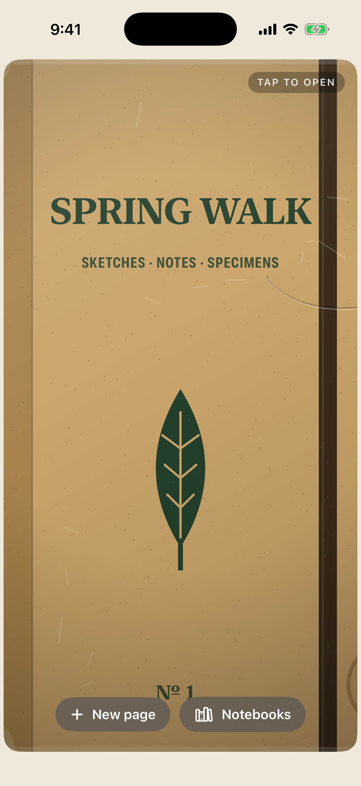
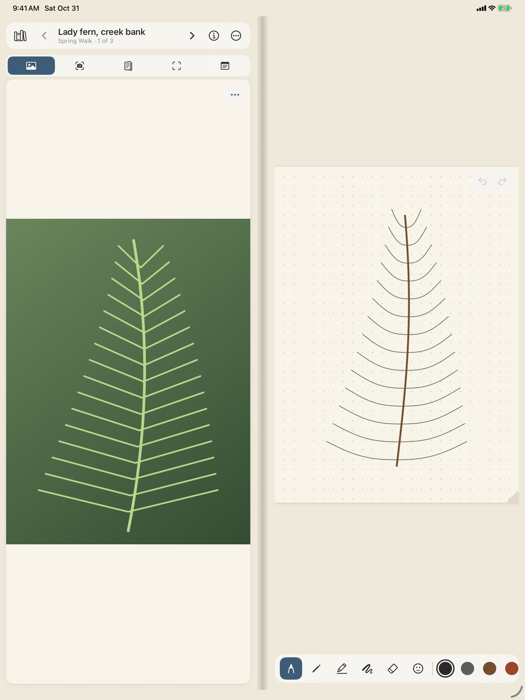
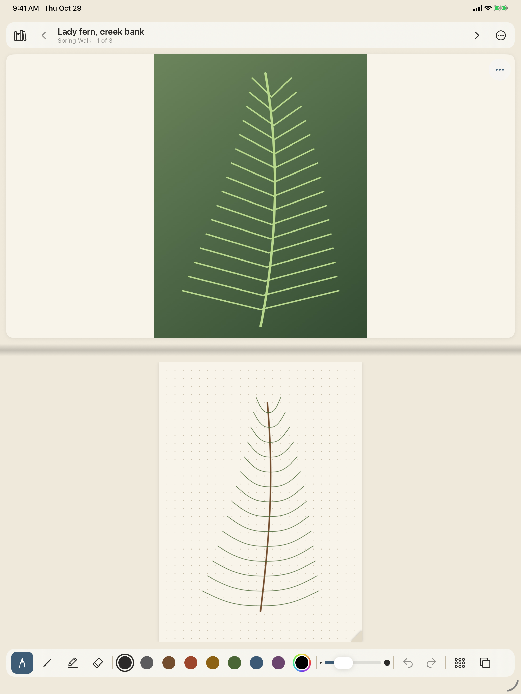

# Field Guide

A pocket field guide for the iPhone Duo. The left page holds a reference (a photo or typed
notes), and the right page is a PencilKit sketch canvas. Closed, it's a quick-capture
notebook on the outer display. Opened, it's a two-page spread you draw across.

SwiftUI, SwiftData and PencilKit. Fully offline, with no accounts, backend or third-party
dependencies.

| Closed | Book | Laptop | Tent |
| --- | --- | --- | --- |
|  |  |  |  |

CI regenerates the screenshots on every push (see [Build and verify](#build-and-verify)).
When the Xcode on the runner has no iPhone Duo simulator, they come from stand-ins: an
iPhone for closed and an iPad for the open postures.

## Setup

Requirements: macOS with Xcode 26 or newer (Xcode 27.1+ enables the iPhone Duo APIs) and
[XcodeGen](https://github.com/yonaskolb/XcodeGen).

```sh
brew install xcodegen
cd FieldGuide
xcodegen generate          # creates FieldGuide.xcodeproj (git-ignored)
open FieldGuide.xcodeproj
```

To use the hinge and fold APIs when building from Xcode with the iOS 27.1+ SDK, add
`FIELDGUIDE_DUO_SDK` to the FieldGuide target's *Active Compilation Conditions*.
`scripts/ci.sh` does this automatically.

Launch arguments, useful in the scheme or in `simctl launch`:

| Argument | Effect |
| --- | --- |
| `-FGPostureOverride closed\|book\|laptop\|tent` | Force a posture, e.g. to try the spread on an iPad simulator |
| `-FGSeedDemo` | Seed a sample "Spring Walk" notebook |
| `-FGInMemoryStore` | Use a throwaway in-memory SwiftData store |

## Build and verify

```sh
scripts/ci.sh            # xcodegen + build + unit tests; fails on any compiler warning
scripts/screenshots.sh   # launches each posture in a simulator, saves screenshots/*.png
```

`.github/workflows/fieldguide-ios.yml` runs both scripts on a GitHub macOS runner on every
push that touches `FieldGuide/`, and commits refreshed screenshots back to the branch.

Unit tests (Swift Testing, `FieldGuideTests/`) cover:

- `PostureMapperTests`: the posture mapping for every hinge/fold/size combination, hinge
  rects, and the provider's override handling
- `WorkspaceLayoutTests`: in book and laptop postures, nothing crosses the hinge, and frames
  are never negative
- `DrawingPersistenceTests`: PKDrawing encode/decode round trips (including through a
  SwiftData `Page`), autosave debounce, flush-on-page-change
- `ExportServiceTests`: page PNG and spread PNG validity, size and content; PDF page counts;
  file naming
- `ModelTests`: search, tags, page ordering, relative image paths, the app model flow
- `ContrastTests`: WCAG 4.5:1 for every ink and for UI text in light and dark mode

## Architecture

```
FieldGuide/
├─ App/          FieldGuideApp, RootView, AppModel, WorkspaceView, WorkspaceHeader
├─ Shared/       Models (SwiftData), Posture + PostureProvider, WorkspaceLayout,
│                ImageStore, Theme, DemoContent
├─ Canvas/       CanvasStore, CanvasView (PKCanvasView wrapper), ToolStrip, PaperRenderer
├─ Reference/    ReferenceSlot (zoom/expand/notes), CameraCaptureView (AVFoundation)
├─ Gallery/      LibraryView (notebooks + gallery grid), PageInfoSheet, LocationLookup
├─ Export/       ExportService, PageRenderer, ShareExport
└─ Resources/    Assets (paper/slate colors, icon), Info.plist (generated)
FieldGuideWidget/  Lock Screen / Home Screen "new page" widget
FieldGuideTests/   Swift Testing suites
```

- **Models.** `Notebook` → `Page` → `ReferenceAsset`, in SwiftData. Each `Page` stores its
  `PKDrawing` as `Data`. Reference images are JPEG files under
  `Application Support/FieldGuide/References/`, and SwiftData stores only their relative
  paths. Gallery thumbnails are small JPEGs in external storage.
- **`PostureProvider`** (protocol) is the only place that knows about hinges.
  `SystemPostureProvider` combines hinge status and angle (`onHingeChange`), the fold's
  `.division` reserved region, and the window size, then maps them through `PostureMapper`
  (pure, tested) to `closed / book / laptop / tent` plus a hinge rect. You can swap the
  provider for another implementation.
- **`CanvasStore`** owns the `PKDrawing`, the `UndoManager` (PencilKit's undo is routed to
  it), the tool, color and width, the paper style, tracing mode, zoom, and the scroll
  position. It debounces autosave after each stroke ends and flushes on page change and
  whenever the scene leaves `.active`.
- **`AppModel`** owns the store and the current notebook and page, sits above every layout,
  and persists drawings back to SwiftData.
- **`WorkspaceView`** keeps the same panes (header, reference, gutter, canvas, tools)
  mounted in every posture. `WorkspaceLayout` (pure, tested) gives each pane a frame, and
  posture changes animate those frames over about 0.35 s, or crossfade under Reduce
  Motion. The `PKCanvasView` is therefore never rebuilt.
- **`ExportService`** renders from a plain `ExportPage` snapshot. It produces a page PNG,
  a spread PNG (reference and sketch side by side), and a notebook PDF (a cover, then one
  spread per page).

### Folding without losing strokes

1. The canvas view is a single long-lived instance. The representable even hands back the
   store's existing `PKCanvasView` if SwiftUI ever rebuilds it.
2. Posture changes that arrive while a stroke is in progress (`isDrawing`, between PencilKit's
   begin/end tool callbacks) wait. The layout switches the moment the stroke ends.
3. The page has a fixed logical size (800 × 1100 pt) and zoom is stored relative to "whole
   page fits". A resize therefore only changes the zoom scale, never stroke coordinates.
   The visible centre and zoom are restored after every resize.
4. The current stroke is saved on stroke end (debounced), and pending changes are flushed
   whenever the scene goes inactive.

## Posture assumptions

The fold detection is built on Apple's iOS 27.1 iPhone Duo APIs as documented by
third-party sample code. I couldn't read Apple's own docs from the build environment, and
"tent" has no API. See **[NOTES.md](NOTES.md)** for the mapping rules, the thresholds, and
every assumption about unknown or unavailable APIs.

## Feature checklist

- Notebooks (create, rename, delete) and pages with an auto-timestamped title
- Reference slot: camera (AVFoundation), photo library (PhotosPicker) or typed notes;
  pinch to zoom, tap to expand
- Canvas: pen, pencil, marker and eraser; 8 inks plus a custom color; width slider;
  undo/redo; blank, dotted, grid and lined paper; finger and Apple Pencil input
- Tracing mode: the reference at 30% opacity under the canvas
- Field metadata: place name (with an optional one-tap current place; permission is asked
  only on tap), date, tags
- Gallery: a thumbnail grid per notebook, searchable by title and `#tag`
- Export: page PNG, spread PNG, notebook PDF
- Closed: one-tap new page, camera shortcut, last-page peek, compact tool strip
- Lock Screen / Home Screen widget → `fieldguide://new-page`
- Warm paper and dark slate paper, hinge gutter, page-turn curl, haptics, Dynamic Type,
  VoiceOver labels, Reduce Motion
