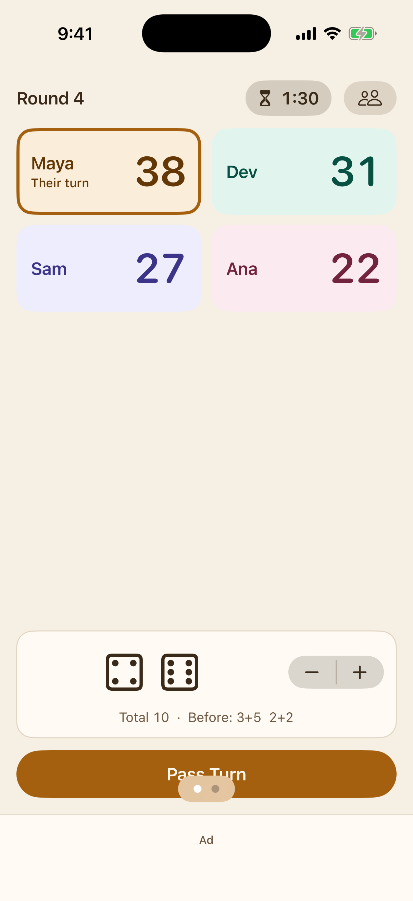
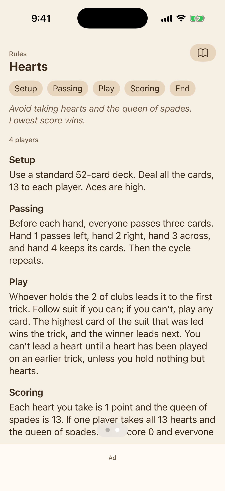
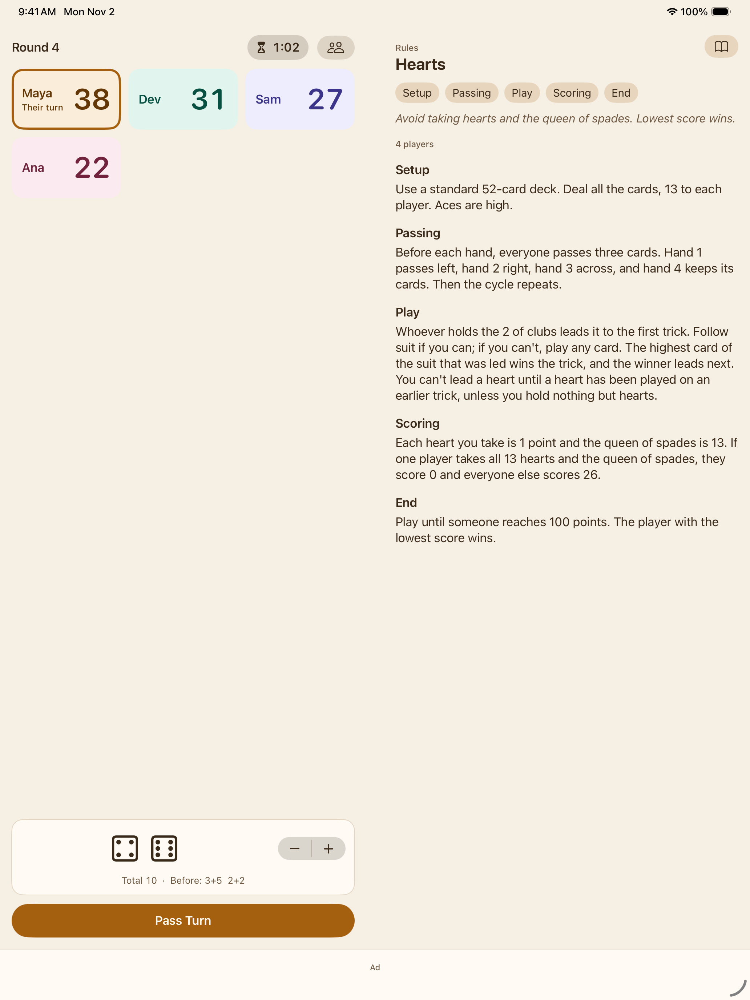
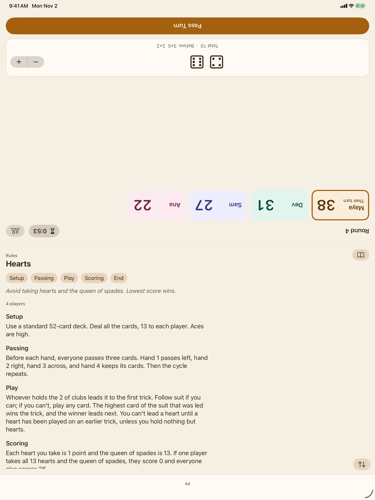

# Game Host

A board-game companion for the iPhone Duo. Stand it up in tent mode and the table side
(scores, turn timer, dice) faces the players while the rules face the host. Open flat, the
two sides sit either side of the hinge. On a phone with one screen, swipe between them.

SwiftUI, no accounts or backend. The game is saved on the device after every change.

| Closed | Rules | Book | Tent |
| --- | --- | --- | --- |
|  |  |  |  |

## How it works at the table

- **Player tiles:** tap +1, swipe right +5 (a long swipe is +10), swipe left −1, press and hold to type any amount.
- **Pass Turn:** moves to the next player, starts a new round after the last one, and restarts the turn timer. Tap the timer to pause it.
- **Dice:** tap the dice to roll; the stepper sets 1 to 6 dice. The last five rolls are kept.
- **Shake to undo:** takes back the last score change or turn pass. Shake again right after to redo.
- **Rules:** our own write-ups of ten public-domain classics (Hearts, Spades, Crazy Eights,
  Rummy, Farkle, Liar's Dice, Chess, Checkers, Backgammon, Dominoes). Commercial rulebooks are
  never bundled.

## Not built yet

- The ad SDK: `AdBannerSlot` keeps the 50 pt banner space with a placeholder.
- The one-time Pro unlock (themes, saved groups, more rules packs).
- The user's own rulebooks (photos or typed text, kept on the device).
- App icon and launch art.

## Setup

Requirements: macOS with Xcode 26 or newer (Xcode 27.1+ enables the iPhone Duo APIs) and
[XcodeGen](https://github.com/yonaskolb/XcodeGen).

```sh
brew install xcodegen
cd GameHost
xcodegen generate
open GameHost.xcodeproj
```

Add `GAMEHOST_DUO_SDK` to *Active Compilation Conditions* to use the hinge APIs when building
from Xcode with the iOS 27.1+ SDK; `scripts/ci.sh` does this automatically.

| Launch argument | Effect |
| --- | --- |
| `-GHPostureOverride closed\|book\|laptop\|tent` | Force a posture |
| `-GHSeedDemo` | Start with a four-player Hearts game |
| `-GHShowRules` | On one screen, open on the rules page |

## Build and verify

```sh
scripts/ci.sh            # xcodegen + build + unit tests; fails on any compiler warning
scripts/screenshots.sh   # saves screenshots/*.png for each posture
```

`.github/workflows/gamehost-ios.yml` runs both on every push to a `claude/**` branch that
touches `GameHost/`, and commits refreshed screenshots back to the branch.

The posture code (`Shared/Posture.swift`, `Shared/PostureProvider.swift`) is copied from
Field Guide.
